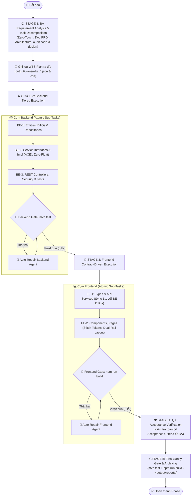

# 🚀 Autonomous Software Engineering Team (CrewAI)

Hệ thống đội ngũ kỹ sư phần mềm tự động (Autonomous Software Engineering Flow) xây dựng trên nền tảng **CrewAI**. Hệ thống tự động phân tích các tài liệu đặc tả dự án từ `plans/` (PRD, Kiến trúc hệ thống, Lộ trình triển khai), phân rã thành các nhiệm vụ nguyên tử (Work Breakdown Structure - WBS), và phối hợp các Agent chuyên trách lập trình Full-Stack (**Spring Boot 3.x + React 19 Vite**) đạt chuẩn **SOLID, ACID, Zero-Float** và thiết kế **Fintech Prestige Stitch UI**.

---

## 📌 Mục Lục
1. [Kiến Trúc & Luồng Thực Thi Mới (New Flow Workflow)](#-kiến-trúc--luồng-thực-thi-mới-new-flow-workflow)
2. [Cấu Trúc Thư Mục Dự Án](#-cấu-trúc-thư-mục-dự-án)
3. [Cài Đặt & Cấu Hình Môi Trường](#-cài-đặt--cấu-hình-môi-trường)
4. [Hướng Dẫn Khởi Chạy (How to Run)](#-hướng-dẫn-khởi-chạy-how-to-run)
5. [Lộ Trình Các Phase & Danh Sách Lệnh](#-lộ-trình-các-phase--danh-sách-lệnh)
6. [Cơ Chế Theo Dõi Tiến Trình & Log WBS](#-cơ-chế-theo-dõi-tiến-trình--log-wbs)
7. [Khởi Chạy Ứng Dụng Đã Tạo (Deployment)](#-khởi-chạy-ứng-dụng-đã-tạo-deployment)

---

## 🔄 Kiến Trúc & Luồng Thực Thi Mới (New Flow Workflow)

Hệ thống áp dụng kiến trúc **Hierarchical Decomposition & Atomic Execution Pipeline** (Phân rã kế hoạch theo tầng & Thực thi nguyên tử) kết hợp **Cổng kiểm soát chất lượng sớm (Fail-Fast Build Gates)**:



### Các Đặc Điểm Vượt Trội Của Flow Mới:
* **BA Zero-Touch Decomposition**: BA đọc toàn bộ PRD, Architecture, và cây thư mục hiện tại để tự động sinh bảng phân rã WBS chuẩn JSON/Markdown mà không cần người dùng can thiệp thủ công.
* **Lưu Trữ Log Minh Bạch**: Bảng kế hoạch chi tiết được tự động lưu vào `output/plans/wbs_<phase>_<timestamp>.json` và `.md` để tiện kiểm tra, audit.
* **Thực thi nguyên tử (Atomic Execution)**: Chia nhỏ thành các task con có ranh giới file rõ ràng (`BE-1`, `BE-2`, `BE-3`, `FE-1`, `FE-2`, `QA-1`), loại bỏ hoàn toàn tình trạng agent bị quá tải ngữ cảnh (context drift) hay sinh mã stub.
* **Kiểm tra sớm (Fail-Fast Gate & Auto-Repair)**:
  - Backend phải vượt qua `mvn test` (toàn bộ unit & integration tests) trước khi Frontend được phép bắt đầu code.
  - Frontend phải vượt qua `npm run build` (0 lỗi TypeScript/Vite).
  - Tự động kích hoạt agent sửa lỗi trực tiếp nếu phát hiện build/test fail.

---

## 📁 Cấu Trúc Thư Mục Dự Án

```text
CrewAI/
├── backend/                              # ☕ Phân hệ Spring Boot 3.x (Java 17/21, Security 6, JPA)
├── frontend/                             # ⚛️ Phân hệ React 19 + TypeScript + Vite + Tailwind CSS
├── design/                               # 🎨 Mẫu giao diện Stitch Web App UI (HTML, CSS Tokens)
│   ├── fintech_prestige/DESIGN.md        # Token thiết kế: Bảng màu, Phông chữ, Spacing
│   ├── finman_web_giao_d_ch_dashboard/   # Dashboard & Sổ cái giao dịch
│   ├── finman_web_ng_nh_p_h_th_ng/       # Màn hình Đăng nhập (Login Split Screen)
│   ├── finman_web_ng_k_t_i_kho_n/        # Màn hình Đăng ký (Register Split Screen)
│   ├── finman_web_popup_th_m_giao_d_ch_m_i/ # Modal Thêm giao dịch Glassmorphism
│   ├── finman_web_qu_n_l_ng_n_s_ch/      # Quản lý ngân sách chi tiêu
│   ├── finman_web_t_i_kho_n_t_i_s_n_r_ng/# Màn hình Tài sản ròng & Ví tiền
│   └── finman_web_th_ng_k_b_o_c_o/       # Màn hình Thống kê báo cáo dòng tiền
├── plans/                                # 📋 Tài liệu kế hoạch & đặc tả nghiệp vụ
│   ├── PRD.md                            # Yêu cầu sản phẩm (Product Requirements)
│   ├── ARCHITECTURE_PLAN.md              # Kiến trúc hệ thống, DB Schema, REST API
│   ├── IMPLEMENT_PLAN.md                 # Các mốc triển khai 10 Phase
│   ├── TEST_PLAN.md                      # Kế hoạch kiểm thử & nghiệm thu QA
│   └── phases/                           # Chi tiết yêu cầu từng phase (phase_0.md -> phase_9.md)
├── web_builder/                          # 🧠 Core CrewAI Engine & Flow Pipeline
│   ├── pyproject.toml                    # Cấu hình CrewAI Flow project
│   └── src/web_builder/
│       ├── main.py                       # Flow logic (CodingFlow: BA -> BE -> FE -> QA -> Gate)
│       ├── crews/content_crew/           # Module ContentCrew (Agents, Tasks, isolated Crews)
│       │   ├── config/agents.yaml        # Định nghĩa 4 Agents (BA, Backend, Frontend, QA)
│       │   ├── config/tasks.yaml         # Định nghĩa các atomic tasks (Approach A)
│       │   └── content_crew.py           # ContentCrew class & tool integrations
│       └── tools/                        # Bộ công cụ lập trình (write_file, patch_file, v.v.)
├── output/                               # 📊 Thư mục lưu kết quả, tiến độ và log kế hoạch
│   ├── plans/                            # Log WBS do BA sinh ra (JSON & Markdown)
│   │   ├── latest_wbs.json               # Kế hoạch phân rã mới nhất
│   │   └── wbs_<phase>_<timestamp>.json  # Kế hoạch có gắn mốc thời gian
│   ├── reports/                          # Kho lưu trữ báo cáo nghiệm thu theo phase
│   ├── coding_team_report.md             # Báo cáo nghiệm thu mới nhất
│   ├── progress.json                     # Tiến độ thời gian thực (JSON)
│   └── progress.md                       # Tiến độ dạng bảng Markdown
├── main.py                               # 🚀 CLI Runner chính (Hỗ trợ tham số --phase, --mode, v.v.)
├── test_crew.py                          # 🛠️ Script kiểm tra môi trường và API key
├── docker-compose.yml                    # 🐳 Orchestration: Postgres + Backend + Frontend
├── .env.example                          # File mẫu biến môi trường
└── .env                                  # File cấu hình API key cá nhân
```

---

## ⚙️ Cài Đặt & Cấu Hình Môi Trường

### 1. Chuẩn Bị Môi Trường
* **Python**: Yêu cầu phiên bản `>= 3.10`.
* **Java**: JDK 17 hoặc JDK 21 và Apache Maven.
* **Node.js**: Phiên bản `>= 18` và npm.

Khởi tạo và kích hoạt môi trường ảo:
```powershell
python -m venv .venv
.\.venv\Scripts\Activate.ps1
pip install -r requirements.txt
```

### 2. Cấu Hình File `.env`
Tạo file `.env` từ file mẫu `.env.example`:

```bash
# Chọn LLM Provider: openrouter | openai | gemini
LLM_PROVIDER=openrouter
OPENROUTER_API_KEY=sk-or-v1-your-api-key-here
MODEL=openrouter/google/gemini-2.5-flash

# Hoặc dùng OpenAI chính thức:
# LLM_PROVIDER=openai
# OPENAI_API_KEY=sk-proj-your-api-key-here
# MODEL=gpt-4o-mini

# Số lượt tự động sửa lỗi tối đa nếu build/test fail (Mặc định: 3)
MAX_REPAIR_ATTEMPTS=3

# Tùy chọn Crew Process: sequential | hierarchical
CREW_PROCESS=sequential
```

---

## 💻 Hướng Dẫn Khởi Chạy (How to Run)

### 1. Kiểm Tra Sức Khỏe Môi Trường (System Diagnostics)
Trước khi chạy bất kỳ pipeline nào, chạy lệnh sau để kiểm tra môi trường, API key và các công cụ:
```powershell
python test_crew.py
```
> Khi màn hình hiển thị `✅ ALL CHECKS PASSED`, hệ thống đã sẵn sàng 100%.

---

### 2. Khởi Chạy Theo Phase Với CLI `main.py` (Khuyên Dùng)

Lệnh `main.py` ở thư mục gốc được trang bị đầy đủ tham số điều khiển và mặc định chạy chế độ **Flow mới** (BA phân rã WBS + Cổng kiểm tra Fail-Fast).

#### Chạy Một Phase Cụ Thể (Ví dụ: Phase 6):
```powershell
python main.py --phase 6
```

#### Chạy Một Nhiệm Vụ Con Cụ Thể (Ví dụ: Task 4.1 trong Phase 4):
```powershell
python main.py --phase 4 --task 4.1
```

#### Chạy Toàn Bộ Các Phase Từ Đầu Đến Cuối:
```powershell
python main.py --phase all
```

#### Tùy Chọn Động LLM Trực Tiếp Từ Dòng Lệnh:
```powershell
# Chạy với Gemini qua OpenRouter
python main.py --phase 6 --provider openrouter --model openrouter/google/gemini-2.5-flash

# Chạy với OpenAI GPT-4o-mini
python main.py --phase 6 --provider openai --model gpt-4o-mini

# Chạy với endpoint OpenAI-compatible tùy biến (DeepSeek, vLLM, Ollama)
python main.py --phase 6 --provider openai --base-url https://api.deepseek.com/v1 --model deepseek-chat
```

#### Lựa Chọn Pipeline Engine (`--mode`):
* `--mode flow` *(Mặc định)*: Luồng Flow đa tầng, BA phân rã tự động thành WBS, lưu log ra đĩa, kiểm tra `mvn test` và `npm run build` ở từng tầng.
* `--mode crew`: Chạy chế độ Crew truyền thống.
```powershell
python main.py --phase 6 --mode flow
```

---

### 3. Khởi Chạy Bằng CrewAI CLI (`crewai run`)
Nếu bạn muốn sử dụng công cụ chuẩn của CrewAI:
```powershell
crewai run
```
Lệnh này sẽ tự động khởi động `CodingFlow` thông qua cấu hình trong `web_builder/pyproject.toml`.

---

### 4. Kiểm Tra Độc Lập Mã Nguồn Sau Khi Sinh (Sanity Check)

Bạn có thể tự chạy kiểm tra mã nguồn bất cứ lúc nào:
* **Kiểm tra Backend (Toàn bộ 44+ tests)**:
  ```powershell
  cd backend
  mvn test
  cd ..
  ```
* **Kiểm tra Frontend (TypeScript & Vite build)**:
  ```powershell
  cd frontend
  npm run build
  cd ..
  ```

---

## 🎯 Cơ Chế Lộ Trình Động & Độc Lập Dự Án (Project-Agnostic Architecture)

Hệ thống **hoàn toàn không bị ràng buộc hay cố định vào một dự án cụ thể nào (Zero Hardcoding)**. Toàn bộ tên bài toán, kiến trúc dữ liệu, các entity, REST endpoint, giao diện, và các phase triển khai đều được **bóc tách tự động 100% từ thư mục `plans/` và `design/`**:
- **Muốn xây dựng dự án mới (CRM, E-Commerce, HRM, v.v.)**: Bạn chỉ cần đặt tài liệu (`PRD.md`, `ARCHITECTURE_PLAN.md`, `IMPLEMENT_PLAN.md` hoặc các file trong `plans/phases/`) vào thư mục `plans/`, và mẫu giao diện HTML/CSS vào `design/` (hoặc truyền qua cờ `--plans-dir <đường_dẫn>` và `--design-dir <đường_dẫn>`).
- Các Agent sẽ tự động đọc, hiểu miền nghiệp vụ mới, và lập trình chính xác theo hợp đồng đó.

### Bảng Lộ Trình Mẫu (Dựa trên tài liệu tham chiếu hiện tại trong `plans/`):

| Phase | Tên Phase & Trọng Tâm Nghiệp Vụ | Lệnh Chạy CLI |
| :---: | :--- | :--- |
| **Phase 0** | Khởi tạo dự án, Design Tokens, Cấu hình Docker Compose | `python main.py --phase 0` |
| **Phase 1** | Database Models, Repositories, Seeder dữ liệu mặc định | `python main.py --phase 1` |
| **Phase 2** | Authentication Fullstack: Security & JWT Filter, Login/Register | `python main.py --phase 2` |
| **Phase 3** | Danh mục & Tài nguyên cốt lõi, CRUD, Tính toán tổng hợp | `python main.py --phase 3` |
| **Phase 4** | Core Engine nghiệp vụ (ACID, toàn vẹn dữ liệu) & Màn hình Dashboard | `python main.py --phase 4` |
| **Phase 5** | Quản lý hạn mức & Giám sát ngân sách, Cảnh báo tự động | `python main.py --phase 5` |
| **Phase 6** | Trí Tuệ Nhân Tạo AI: Xử lý ngôn ngữ tự nhiên & Trợ lý thông minh | `python main.py --phase 6` |
| **Phase 7** | Cài đặt hệ thống, Hồ sơ người dùng & Cá nhân hóa giao diện | `python main.py --phase 7` |
| **Phase 8** | Báo cáo thống kê, Biểu đồ phân tích dữ liệu, Xuất file (.xlsx / PDF) | `python main.py --phase 8` |
| **Phase 9** | Nghiệm thu QA toàn diện: Audit Codebase Health, Verify Docker production | `python main.py --phase 9` |
| **ALL** | Chạy toàn bộ các Phase liên tục từ đầu đến cuối theo kế hoạch | `python main.py --phase all` |

---

## 📊 Cơ Chế Theo Dõi Tiến Trình & Log WBS

Sau mỗi lần chạy, bạn có thể kiểm tra kết quả qua các kênh lưu trữ:

1. **Bảng Kế Hoạch WBS Của BA (`output/plans/`)**:
   - `output/plans/latest_wbs.json`: Bản đồ phân rã task con mới nhất gồm `backend_tasks`, `frontend_tasks`, `acceptance_criteria`.
   - `output/plans/wbs_<phase>_<timestamp>.md`: Bản giải trình chi tiết về kiến trúc của BA.
2. **Tiến Trình Thời Gian Thực (`output/progress.json` & `output/progress.md`)**:
   - Cập nhật tỷ lệ % hoàn thành, task hiện tại, thời gian chạy phục vụ tích hợp dashboard.
3. **Báo Cáo Nghiệm Thu QA (`output/coding_team_report.md` & `output/reports/`)**:
   - Chứa kết quả chạy test thực tế từ terminal, xác nhận 0 lỗi biên dịch, 0 test fail, và 0 file stub.

---

## 🐳 Khởi Chạy Ứng Dụng Đã Tạo (Deployment)

Sau khi pipeline hoàn tất, bạn có thể khởi chạy ứng dụng Full-Stack bằng Docker:

```powershell
# Build và chạy ngầm toàn bộ container (PostgreSQL + Backend + Frontend)
docker compose up --build -d

# Xem log các dịch vụ
docker compose logs -f

# Dừng toàn bộ dịch vụ
docker compose down
```

### Các Cổng Dịch Vụ:
* **Frontend Web App**: [http://localhost:3000](http://localhost:3000) hoặc [http://localhost:5173](http://localhost:5173)
* **Backend REST API**: [http://localhost:8080/api](http://localhost:8080/api)
* **PostgreSQL Database**: `localhost:5432` (Database: `finman_db`)
