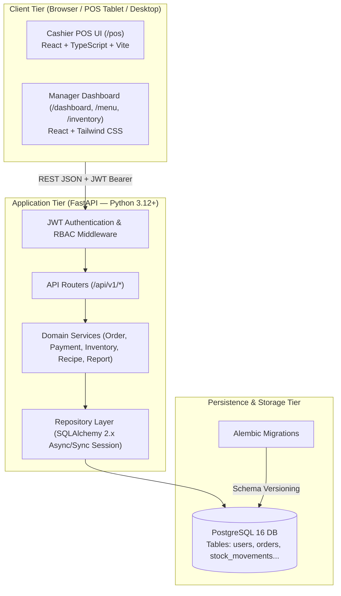

# ARCHITECTURE.md — System Architecture & Components (CoffeeFlow)

## 1. High-Level Architecture Diagram



---

## 2. Technology Stack

| Layer | Technology | Key Libraries / Frameworks |
| :--- | :--- | :--- |
| **Backend** | Python 3.12+ | FastAPI, Pydantic v2, SQLAlchemy 2.x, Alembic, Pytest, HTTPX, Passlib/Bcrypt, PyJWT |
| **Database** | PostgreSQL 16 | Relational persistence, Indexing, Transactions with row-level locks (`SELECT FOR UPDATE`) |
| **Frontend** | React + TypeScript | Vite, Tailwind CSS, TanStack Query, React Router v6, React Hook Form, Zod, Recharts, Lucide Icons |
| **Orchestration**| Docker Compose | Multi-container setup (PostgreSQL, Backend API, Frontend Web) |
| **Flow Engine** | CrewAI | Python Multi-Agent Software Engineering Flow (BA, Backend, Frontend, QA) |

---

## 3. Package & Directory Structure

### 3.1. Backend Directory Structure (`backend/`):
```text
backend/
├── app/
│   ├── api/
│   │   └── v1/
│   │       ├── auth.py          # /api/v1/auth (login, logout, me)
│   │       ├── users.py         # /api/v1/users (cashier management)
│   │       ├── categories.py    # /api/v1/categories
│   │       ├── products.py      # /api/v1/products (items, options, availability)
│   │       ├── orders.py        # /api/v1/orders (create, confirm, cancel)
│   │       ├── payments.py      # /api/v1/payments & /orders/{id}/payments
│   │       ├── inventory.py     # /api/v1/inventory (ingredients, movements, recipes)
│   │       ├── dashboard.py     # /api/v1/dashboard/summary
│   │       └── reports.py       # /api/v1/reports (sales, products, inventory)
│   ├── core/
│   │   ├── config.py            # Environment settings (Pydantic BaseSettings)
│   │   ├── security.py          # Password hashing, JWT token creation/verification
│   │   ├── exceptions.py        # Custom business exceptions & handlers
│   │   └── dependencies.py      # DB session injection, current_user, require_role(MANAGER)
│   ├── models/                  # SQLAlchemy 2.x ORM Declarative Models
│   │   ├── user.py
│   │   ├── menu.py              # Category, Product, ProductOption
│   │   ├── order.py             # Order, OrderItem
│   │   ├── payment.py           # Payment, Refund
│   │   ├── inventory.py         # Ingredient, Recipe, StockMovement
│   │   └── audit.py             # AuditLog
│   ├── schemas/                 # Pydantic v2 validation schemas (Request/Response DTOs)
│   ├── repositories/            # Data access layer (CRUD queries, concurrency locks)
│   ├── services/                # Business logic services (OrderService, InventoryService)
│   └── main.py                  # FastAPI application factory, CORS, exception handlers
├── alembic/                     # Database migration scripts
│   ├── versions/
│   └── env.py
├── tests/                       # Pytest automated test suites
│   ├── conftest.py
│   ├── test_auth.py
│   ├── test_orders.py
│   ├── test_payments.py
│   └── test_inventory.py
├── pyproject.toml / requirements.txt
└── Dockerfile
```

### 3.2. Frontend Directory Structure (`frontend/src/`):
```text
frontend/src/
├── assets/                      # Icons, logo, static images
├── components/
│   ├── common/                  # Button, Input, Modal, Badge, LoadingSpinner
│   ├── layout/                  # AppShell, TopHeader, NavigationSidebar
│   └── pos/                     # ProductGrid, CartPanel, OptionModal, CheckoutModal
├── pages/
│   ├── LoginPage.tsx            # /login
│   ├── PosPage.tsx              # /pos (Cashier & Manager)
│   ├── OrdersPage.tsx           # /orders & /orders/:id
│   ├── DashboardPage.tsx        # /dashboard (Manager only)
│   ├── MenuManagementPage.tsx   # /menu (Manager only)
│   ├── InventoryPage.tsx        # /inventory (Manager only)
│   ├── ReportsPage.tsx          # /reports/sales (Manager only)
│   └── EmployeesPage.tsx        # /employees (Manager only)
├── services/                    # Axios/Fetch API client with auth interceptors
├── types/                       # TypeScript interfaces 1:1 with Pydantic schemas
├── hooks/                       # Custom hooks (useAuth, useCart, useInventory)
└── App.tsx                      # Route definitions & ProtectedRoute wrapper
```

---

## 4. Key Architectural Patterns & Guarantees

1. **Role-Based Access Control (RBAC)**:
   - Only 2 roles: `CASHIER` and `MANAGER`.
   - Backend enforcement: FastAPI dependencies e.g. `Depends(require_role(["MANAGER"]))`.
   - Frontend route guards prevent navigation, but backend remains the ultimate gatekeeper.
2. **Atomic Order & Stock Operations**:
   - Order confirmation and stock deduction execute in a single DB transaction. If stock is insufficient, the entire operation rolls back with a clear 400/409 error.
3. **Price Snapshot Integrity**:
   - `order_items` stores `product_name_snapshot`, `unit_price`, and `selected_options_snapshot` at the time of order creation. Historical records are immutable.
4. **Idempotency Guard**:
   - Payment requests and order confirmations accept an `Idempotency-Key` header to protect against network retry duplicates.
5. **Standardized Error Envelope**:
   - All errors return a structured JSON response:
   ```json
   {
     "error_code": "INSUFFICIENT_STOCK",
     "message": "Nguyên liệu 'Hạt cà phê Robusta' không đủ tồn kho.",
     "details": {"required": 50, "available": 20}
   }
   ```
