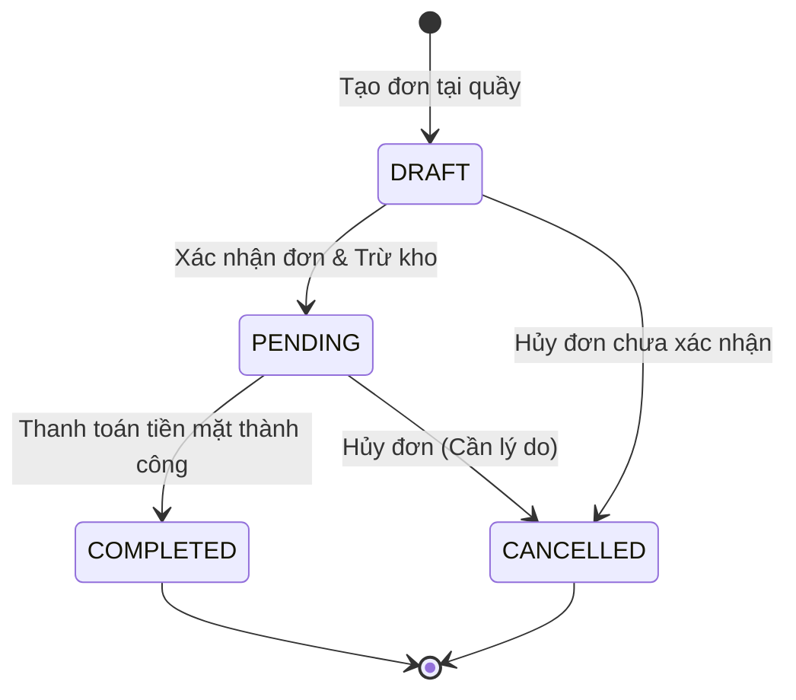

# BUSINESS_RULES.md — Domain Invariants, Formulas & Edge Cases (CoffeeFlow)

Tài liệu này xác định các quy tắc nghiệp vụ bất biến, công thức tính toán và cách xử lý các trường hợp biên của hệ thống **CoffeeFlow**.

---

## 1. Domain Invariants (Quy Tắc Bất Biến)

### 1.1. Zero-Float & Độ Chính Xác Tiền Tệ
- Đơn vị tiền tệ chính thức là Việt Nam Đồng (`VND`).
- Toàn bộ giá trị tiền tệ trong mã nguồn và cơ sở dữ liệu bắt buộc sử dụng kiểu số nguyên (`int` / `BIGINT`) hoặc `Decimal`.
- Tuyệt đối cấm sử dụng kiểu số thực dấu phẩy động (`float` / `double`) trong bất kỳ phép tính nào liên quan đến giá bán, tổng tiền hoặc hoàn tiền.

### 1.2. Snapshot Giá & Lịch Sử Đơn Hàng (Price Immutability)
- Khi thêm sản phẩm vào đơn hàng, hệ thống bắt buộc lưu snapshot:
  - Tên sản phẩm (`product_name_snapshot`).
  - Đơn giá tính toán tại thời điểm đó (`unit_price`).
  - Danh sách tùy chọn size/topping kèm giá cộng thêm (`selected_options_snapshot`).
- **Bất biến lịch sử**: Việc Manager sửa giá sản phẩm, xóa topping hoặc ngừng kinh doanh một món trong menu sau đó **tuyệt đối không làm thay đổi dữ liệu của bất kỳ đơn hàng nào đã tạo**.

### 1.3. Tính Toàn Vẹn Chu Trình Đơn Hàng (Order State Machine)

- `DRAFT`: Đang chọn món, được phép sửa đổi số lượng, thêm/xóa món tùy ý.
- `PENDING`: Đã chốt món và đã trừ kho nguyên liệu. Không thể tự ý sửa món trực tiếp; nếu muốn đổi phải hủy hoặc tạo bút toán điều chỉnh.
- `COMPLETED`: Đã thanh toán tiền mặt đầy đủ và in hóa đơn. Không thể quay lại trạng thái `PENDING` hay `DRAFT`.
- `CANCELLED`: Đã hủy. Không thể thực hiện thanh toán hay tái kích hoạt.
- Đơn hàng đã thanh toán (`COMPLETED`) không thể áp dụng luồng hủy thông thường; nếu khách trả hàng phải thực hiện qua luồng Hoàn tiền (`Refund`).

---

## 2. Công Thức Tính Toán Nghiệp Vụ (Formulas)

### 2.1. Đơn Giá Món & Tổng Tiền Đơn Hàng
$$\text{unit\_price} = \text{base\_price} + \sum \text{price\_delta}_{\text{selected options}}$$
$$\text{item\_subtotal} = \text{unit\_price} \times \text{quantity}$$
$$\text{order\_subtotal} = \sum \text{item\_subtotal}$$
$$\text{total\_amount} = \text{order\_subtotal} - \text{discount\_amount}$$

*Backend Invariant*: Mọi phép tính tổng tiền bắt buộc phải do backend tính toán độc lập. Backend không tin tưởng và không nhận giá trị tổng tiền do client gửi lên.

### 2.2. Thanh Toán Tiền Mặt & Tiền Thối
$$\text{change\_amount} = \text{amount\_tendered} - \text{total\_amount}$$
- Điều kiện bắt buộc: $\text{amount\_tendered} \ge \text{total\_amount}$. Nếu thiếu tiền, backend từ chối ghi nhận giao dịch với mã lỗi `INSUFFICIENT_PAYMENT`.

### 2.3. Báo Cáo Doanh Thu (Sales Metrics)
- **Gross Sales (Doanh thu gộp)**: Tổng giá trị các đơn hàng `COMPLETED` có thanh toán `SUCCESS` trong kỳ.
$$\text{Gross Sales} = \sum \text{Payment.amount}$$
- **Net Sales (Doanh thu thuần)**:
$$\text{Net Sales} = \text{Gross Sales} - \sum \text{Refund.amount}$$
- **Average Order Value (Giá trị đơn trung bình - AOV)**:
$$\text{AOV} = \frac{\text{Gross Sales}}{\text{Số lượng đơn COMPLETED}}$$
- *Lưu ý*: Mọi mốc thời gian báo cáo được tính theo múi giờ `Asia/Ho_Chi_Minh`. Các đơn hàng bị hủy hoặc chưa thanh toán không được tính vào doanh thu.

---

## 3. Quản Lý Kho & Trừ Nguyên Liệu Tự Động

### 3.1. Thời Điểm Trừ Kho & Concurrency Lock
- Việc trừ tồn kho diễn ra ngay khi đơn chuyển sang `PENDING` (xác nhận đơn).
- Quy trình kiểm tra và trừ kho:
  1. Mở database transaction.
  2. Gom nhóm tổng lượng nguyên liệu cần thiết cho toàn bộ món trong đơn dựa trên bảng `recipes`.
  3. Sử dụng `SELECT ... FOR UPDATE` trên các bản ghi `ingredients` tương ứng để tránh tình trạng race condition / lost update khi nhiều Cashier cùng bán một món.
  4. Nếu bất kỳ nguyên liệu nào có $\text{current\_stock} < \text{quantity\_required}$: Rollback toàn bộ transaction và trả về lỗi `INSUFFICIENT_STOCK`.
  5. Cập nhật trừ kho và tạo bản ghi lịch sử `stock_movements` với `movement_type = 'SALE_CONSUMPTION'`.
  6. Commit transaction.

### 3.2. Xử Lý Khi Hủy Đơn Sau Khi Đã Trừ Kho
- Nếu đơn hàng bị hủy sau khi đã ở trạng thái `PENDING`: **Hệ thống KHÔNG tự động cộng lại nguyên liệu vào kho**.
- *Lý do*: Trong quán cafe thực tế, đồ uống đã được pha chế thì nguyên liệu (sữa, đá, cốt cafe) đã bị tiêu hao, không thể đổ ngược lại bao bì. Nếu nguyên liệu còn nguyên vẹn chưa pha, Manager phải vào màn hình Kho tạo một phiếu điều chỉnh tồn kho thủ công (`movement_type = 'ADJUSTMENT'`) kèm lý do.

---

## 4. Chính Sách Hoàn Tiền (Refund Policy)
- Chỉ tài khoản `MANAGER` mới có quyền thực hiện hoàn tiền.
- Bắt buộc phải có lý do hoàn tiền (`reason`).
- **Giới hạn số tiền hoàn**:
$$\text{Refund Amount} \le \text{Payment.amount} - \sum \text{Previous Refunds}$$
- Giao dịch thanh toán gốc không bị xóa; hệ thống tạo bản ghi mới trong bảng `refunds` và ghi nhận một dòng trong `audit_logs`.

---

## 5. Xử Lý Các Trường Hợp Biên (Edge Cases)

1. **Khách hàng nhấn nút thanh toán nhiều lần hoặc mạng chập chờn**:
   - Sử dụng header `Idempotency-Key` (UUID). Nếu server nhận được 2 request cùng key trong vòng 5 phút, trả về ngay kết quả của request đầu tiên mà không tạo thêm giao dịch thanh toán thứ 2.
2. **Sản phẩm hết nguyên liệu trong lúc Cashier đang chọn món**:
   - Khi Cashier nhấn "Xác nhận đơn", bước trừ kho atomic sẽ phát hiện và từ chối, hiển thị tên nguyên liệu bị thiếu để Cashier thông báo ngay cho khách đổi món.
3. **Manager vô hiệu hóa tài khoản Cashier khi Cashier đang mở POS**:
   - Tại mỗi request gọi lên backend, middleware xác thực kiểm tra cờ `is_active` của user. Nếu `is_active == false`, lập tức trả về `401/403` và hủy phiên làm việc.
