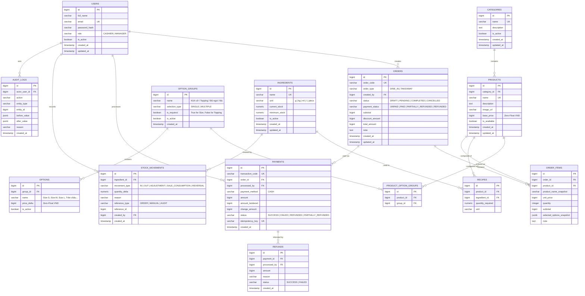

# DATA_MODEL.md — Database Schema, Entities & Constraints (CoffeeFlow)

## 1. Entity-Relationship Diagram (ERD)



---

## 2. Table Specifications & Constraints

### 2.1. `users`
- `role`: Restricted to enum `'CASHIER'`, `'MANAGER'`.
- `email`: Case-insensitive unique constraint.
- `password_hash`: Bcrypt hash (cost >= 10).

### 2.2. `products`, `option_groups`, `options` & `product_option_groups` (Phương án B)
- `products.base_price`: `BIGINT NOT NULL CHECK (base_price >= 0)` (VND integer).
- `option_groups`:
  - `selection_type`: `'SINGLE'` (radio: chọn 1 duy nhất, ví dụ Size, Mức đá, Lượng đường) hoặc `'MULTIPLE'` (checkbox: chọn nhiều, ví dụ Topping).
  - `is_required`: `TRUE` (bắt buộc chọn, ví dụ Size) hoặc `FALSE` (tùy chọn, ví dụ Topping).
- `options`:
  - `price_delta`: `BIGINT NOT NULL DEFAULT 0 CHECK (price_delta >= 0)` (Khoản tiền cộng thêm VND).
- Soft delete / availability: `is_available = FALSE` thay vì xóa cứng.

### 2.3. `orders` & `order_items`
- `order_code`: Unique e.g. `ORD-YYYYMMDD-XXXX`.
- `total_amount = subtotal - discount_amount`.
- `order_items.unit_price = base_price + sum(option_price_deltas)`.
- `selected_options_snapshot`: Lưu cấu trúc JSON array ghi lại chính xác tên nhóm, tên option và giá cộng thêm tại thời điểm đặt đơn:
  ```json
  [
    {"group_name": "Kích cỡ", "option_name": "Size L", "price_delta": 6000},
    {"group_name": "Topping", "option_name": "Kem Phô Mai", "price_delta": 10000}
  ]
  ```

### 2.4. `payments` & `refunds`
- `payment_method`: Defaults to `'CASH'` for MVP.
- `idempotency_key`: Unique string provided by client to prevent duplicate submissions.
- Total refunded amount on any payment cannot exceed `payment.amount`.

### 2.5. `ingredients`, `recipes` & `stock_movements`
- `unit`: Normalized unit strings (`g`, `ml`, `piece`).
- `current_stock`: Updated inside the same transaction as order confirmation.
- Concurrency protection: `SELECT ... FOR UPDATE` on `ingredients` during consumption to prevent lost updates.

### 2.6. `audit_logs`
- Append-only table. Read-only for `MANAGER`, completely forbidden for `CASHIER`.
- Stores sensitive actions: account disablement, price updates, order cancellation, refunds, stock adjustments.

---

## 3. Migration Strategy (Alembic)
- Alembic manages schema versioning in `backend/alembic/versions/`.
- Seed data migration: Default Admin Manager account, initial categories, default option groups (Size, Topping, Ice, Sugar) and starter ingredients.
