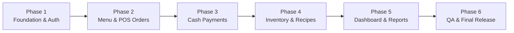

# IMPLEMENT_PLAN.md — Implementation Milestones & Roadmap (CoffeeFlow)

Lộ trình triển khai hệ thống **CoffeeFlow** được chia thành 6 Phase theo thứ tự ưu tiên nghiệp vụ, đáp ứng đầy đủ yêu cầu MVP tại [docs/PRD.md](file:///C:/Users/Minnut/Desktop/VSCode/CrewAI%20-%20Copy/docs/PRD.md).

---

## 1. Roadmap Tổng Thể (Phase Overview)

---

## 2. Chi Tiết Các Phase & Tiêu Chí Nghiệm Thu

### Phase 1: Foundation, Database Models & Authentication
- **Mục tiêu**:
  - Khởi tạo dự án Monorepo: Backend FastAPI (Python 3.12+) & Frontend React (Vite + TypeScript + Tailwind CSS).
  - Cấu hình PostgreSQL 16 & Alembic migration cho bảng `users`.
  - Triển khai xác thực JWT và phân quyền 2 role: `CASHIER` và `MANAGER`.
  - Màn hình Đăng nhập `/login` trên Frontend.
- **Dependencies**: Không.
- **Tiêu chí nghiệm thu**:
  - `POST /api/v1/auth/login` hoạt động đúng cho cả Manager và Cashier.
  - Tài khoản vô hiệu hóa (`is_active = false`) bị từ chối đăng nhập.
  - Màn hình `/login` đăng nhập thành công lưu JWT token và điều hướng đúng role.
  - Backend `pytest` pass 100%, Frontend `npm run build` không có lỗi TypeScript.

### Phase 2: Menu Management & POS Order Creation
- **Mục tiêu**:
  - Quản lý danh mục (`categories`) và sản phẩm (`products`).
  - Quản lý các tùy chọn món (`product_options`: size S/M/L, topping trân châu/thạch).
  - Màn hình POS bán hàng `/pos`: chọn món, chọn size/topping, giỏ hàng, tạo đơn (`orders`, `order_items`).
  - Lưu snapshot giá và tên món tại thời điểm đặt đơn.
- **Dependencies**: Phase 1.
- **Tiêu chí nghiệm thu**:
  - Manager có quyền tạo/sửa menu; Cashier chỉ có quyền đọc menu.
  - Tạo đơn tại quầy (Dine-in / Takeaway) tính đúng `total_amount = base_price + sum(options)`.
  - Lưu snapshot giá chính xác; sửa giá sản phẩm không làm đổi giá đơn cũ.

### Phase 3: Cash Payment & Idempotency
- **Mục tiêu**:
  - Quy trình thanh toán tiền mặt (`CASH`) tại quầy.
  - Tính toán số tiền thối lại (`change_amount = amount_tendered - total_amount`).
  - Cập nhật trạng thái đơn sang `COMPLETED` trong database transaction.
  - Cơ chế chống thanh toán trùng bằng `Idempotency-Key`.
  - Màn hình hóa đơn sau thanh toán và tra cứu đơn hàng `/orders`.
- **Dependencies**: Phase 2.
- **Tiêu chí nghiệm thu**:
  - Thu đủ tiền mặt hoàn tất đơn hàng và sinh mã giao dịch duy nhất.
  - Không thể thanh toán 2 lần cho cùng một đơn hàng.
  - Thu thiếu tiền bị từ chối với lỗi `INSUFFICIENT_PAYMENT`.

### Phase 4: Inventory, Recipes & Auto Stock Deduction
- **Mục tiêu**:
  - Quản lý nguyên liệu (`ingredients`) và đơn vị tính (`g`, `ml`, `piece`).
  - Quản lý công thức pha chế (`recipes`) liên kết giữa sản phẩm và nguyên liệu.
  - Cơ chế tự động trừ kho nguyên tử khi xác nhận đơn hàng (`POST /orders/{id}/confirm`).
  - Phiếu nhập/xuất/điều chỉnh kho (`stock_movements`) và cảnh báo tồn thấp.
- **Dependencies**: Phase 3.
- **Tiêu chí nghiệm thu**:
  - Bán 1 ly Cà phê muối tự động trừ đúng định mức cafe, sữa, muối theo công thức.
  - Khi thiếu nguyên liệu, từ chối xác nhận đơn với thông báo nguyên liệu thiếu cụ thể.
  - Tránh lost update bằng concurrency lock (`SELECT FOR UPDATE`).

### Phase 5: Management Dashboard, Sales Reports & Audit Logs
- **Mục tiêu**:
  - Dashboard tổng quan doanh thu (`/dashboard`) dành riêng cho Manager.
  - Báo cáo doanh thu theo ngày, tuần, tháng (`Gross Sales`, `Net Sales`, `AOV`).
  - Chức năng hoàn tiền (`Refund`) kèm lý do và ghi nhận `audit_logs`.
  - Quản lý tài khoản Cashier (`/employees`).
- **Dependencies**: Phase 4.
- **Tiêu chí nghiệm thu**:
  - Doanh thu khớp 100% với các giao dịch `SUCCESS` trừ đi các khoản hoàn tiền.
  - Cashier tuyệt đối không truy cập được Dashboard, Báo cáo và Audit Logs (HTTP 403).
  - Hoàn tiền vượt quá giá trị đơn bị từ chối.

### Phase 6: Quality Assurance, Security & Performance Hardening
- **Mục tiêu**:
  - Bộ kiểm thử tích hợp toàn diện: test RBAC, test thanh toán trùng, test race condition trừ kho.
  - Tối ưu hóa hiệu năng truy vấn database, đánh index cột thường tìm kiếm.
  - Đóng gói Docker Compose hoàn chỉnh và kiểm thử end-to-end.
- **Dependencies**: Phase 5.
- **Tiêu chí nghiệm thu**:
  - 100% test case P0 (AT-01 đến AT-07 trong PRD) vượt qua.
  - Thời gian phản hồi API p95 dưới 500ms.
  - Hệ thống build và chạy hoàn hảo qua lệnh `docker-compose up`.
