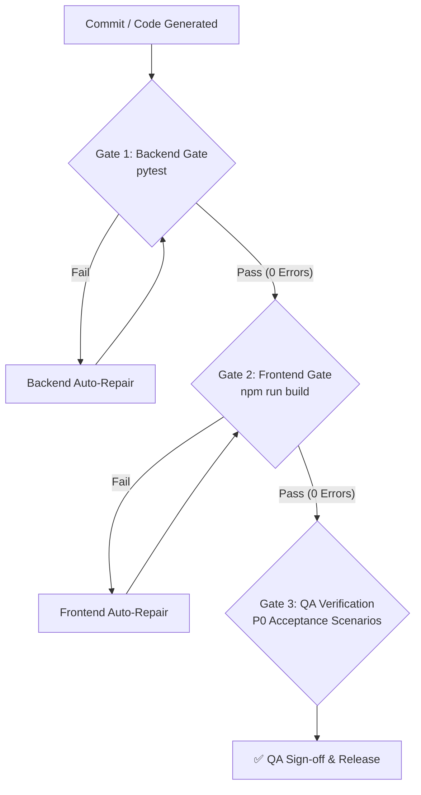

# TEST_PLAN.md — Testing Strategy & Quality Assurance Gates (CoffeeFlow)

Tài liệu này quy định chiến lược kiểm thử tự động, ngưỡng kiểm soát chất lượng (Quality Gates) và các kịch bản kiểm thử nghiệm thu (AT-01 đến AT-07) cho hệ thống **CoffeeFlow**.

---

## 1. Testing Strategy & Quality Gates

Hệ thống áp dụng cơ chế **Fail-Fast Dual Quality Gate**:

---

## 2. Test Execution Commands & Pass Thresholds

| Scope | Test Command | Cwd | Tiêu chí Đạt (Pass Threshold) |
| :--- | :--- | :--- | :--- |
| **Backend Unit & API Tests** | `pytest` | `backend/` | `X passed, 0 failed, 0 errors`, 100% pass |
| **Frontend TypeCheck & Build** | `npm run build` | `frontend/` | Exit code 0, 0 TypeScript errors, 0 Vite bundling errors |
| **Database Migrations** | `alembic check` | `backend/` | Model metadata và database schema đồng bộ hoàn toàn |

---

## 3. P0 Acceptance Test Scenarios (Theo PRD Section 11)

### AT-01: Authentication & Role-Based Access Control
- [ ] Đăng nhập hợp lệ bằng tài khoản Manager nhận JWT token và truy cập được các API quản trị.
- [ ] Đăng nhập hợp lệ bằng tài khoản Cashier bị chặn khi gọi API quản trị menu/kho (HTTP 403 Forbidden).
- [ ] Đăng nhập sai mật khẩu bị từ chối (HTTP 401 Unauthorized).
- [ ] Tài khoản bị vô hiệu hóa (`is_active = false`) không thể tạo phiên đăng nhập mới.
- [ ] Truy cập API bảo vệ mà không gửi kèm JWT Bearer token nhận lỗi 401.

### AT-02: Menu & Price Immutability
- [ ] Manager tạo danh mục và sản phẩm mới thành công.
- [ ] Cashier gọi API tạo/sửa sản phẩm bị từ chối 403.
- [ ] Sản phẩm có cờ `is_available = false` bị từ chối khi thêm vào đơn hàng mới.
- [ ] Manager thay đổi giá sản phẩm; kiểm tra các đơn hàng đã tạo trước đó vẫn giữ nguyên đơn giá snapshot cũ.

### AT-03: Order POS & Calculations
- [ ] Cashier tạo đơn hàng (Dine-in / Takeaway) với nhiều sản phẩm, size và topping.
- [ ] Backend tự động tính toán chính xác: `unit_price = base_price + sum(options)`, `total_amount = sum(unit_price * quantity)`.
- [ ] Gửi số lượng âm hoặc sản phẩm không tồn tại bị từ chối 400.
- [ ] Gửi lại cùng một request kèm cùng một `Idempotency-Key` không tạo ra 2 đơn hàng trùng lặp.
- [ ] Đơn hàng đã ở trạng thái `COMPLETED` không thể bị chỉnh sửa hoặc chuyển lại `PENDING`.

### AT-04: Cash Payment & Idempotency
- [ ] Thanh toán tiền mặt với `amount_tendered >= total_amount`: Đơn chuyển sang `COMPLETED`, tính đúng tiền thối lại `change_amount`.
- [ ] Thanh toán với số tiền thiếu (`amount_tendered < total_amount`) bị từ chối với mã lỗi `INSUFFICIENT_PAYMENT`.
- [ ] Thanh toán cho đơn hàng đã hủy (`CANCELLED`) bị từ chối.
- [ ] Thanh toán lặp (double-click hoặc retry mạng) không tạo thêm giao dịch thu tiền thứ 2.
- [ ] Hoàn tiền: Manager hoàn tiền thành công kèm lý do; hoàn tiền vượt quá số tiền của đơn bị từ chối.

### AT-05: Inventory & Atomic Stock Deduction
- [ ] Khi xác nhận đơn (`POST /orders/{id}/confirm`), hệ thống tự động trừ đúng lượng tồn kho của từng nguyên liệu theo công thức `recipes`.
- [ ] Nếu một nguyên liệu không đủ tồn kho, toàn bộ giao dịch xác nhận đơn bị rollback (không trừ dở dang bất kỳ nguyên liệu nào) và trả về lỗi `INSUFFICIENT_STOCK`.
- [ ] Kiểm thử race condition: Hai đơn hàng đồng thời mua sản phẩm dùng chung một nguyên liệu giới hạn số lượng không gây ra hiện tượng âm kho (lost update).
- [ ] Thao tác nhập kho và điều chỉnh tồn kho cập nhật đúng số lượng và lưu lịch sử `stock_movements`.

### AT-06: Sales Reports & Consistency
- [ ] Dashboard KPI hiển thị khớp 100% với các giao dịch `SUCCESS` trừ đi các khoản hoàn tiền (`Net Sales = Gross Sales - Refunds`).
- [ ] Đơn hàng chưa thanh toán hoặc bị hủy không bị tính vào doanh thu.
- [ ] Bộ lọc theo ngày/tuần/tháng tính đúng múi giờ `Asia/Ho_Chi_Minh`.

---

## 4. QA Sign-Off Checklist
- [ ] 100% P0 test scenarios pass.
- [ ] Backend `pytest` pass không có warning nghiêm trọng.
- [ ] Frontend `npm run build` pass không có lỗi TypeScript hoặc lint.
- [ ] Không có file 0-byte hoặc code stub chưa hoàn thiện.
- [ ] Toàn bộ log kiểm thử thực tế được lưu vào `output/coding_team_report.md`.
